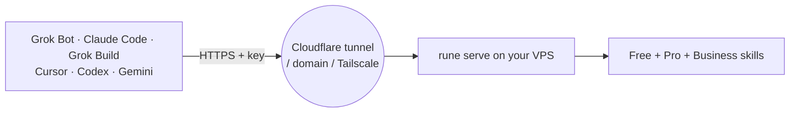

<p align="center">
  
</p>

<p align="center">
  <strong>Less skills. Deeper connections.</strong><br>
  A disciplined, interconnected skill mesh for AI coding agents.<br>
  67 skills · 248 connections · 46 signals · 16 platforms · MIT
</p>

<p align="center">
  <a href="https://skills.sh/rune-kit/rune"></a>
  <a href="https://www.npmjs.com/package/@rune-kit/rune"></a>
  <a href="LICENSE"></a>
  <a href="https://rune-kit.github.io/rune"></a>
  <a href="https://t.me/xlabs_updates"></a>
</p>

<p align="center">
  <strong>Claude Code</strong> · <strong>OpenAI Codex</strong> · <strong>Grok Build</strong> · <strong>Cursor</strong> · <strong>Antigravity</strong> · <strong>Gemini CLI</strong> · <strong>GitHub Copilot</strong> · <strong>Cline</strong> · <strong>Windsurf</strong> · <strong>Kiro</strong> · <strong>Amp</strong> · <strong>Goose</strong> · any Agent Skills runtime
</p>

```bash
npx skills add rune-kit/rune
```

<sub>One command, ~80 agents: installs every Rune skill into the agents you pick, via <a href="https://skills.sh/rune-kit/rune">skills.sh</a>. For hooks, subagents and the full mesh, use the native install for your agent below.</sub>

<!--
  ╔══════════════════════════════════════════════════════════════════╗
  ║  DEMO GIF PLACEHOLDER — replace before launch                     ║
  ║  Target: assets/demo.gif, ≤ 60 s, ≤ 8 MB, 1280×720                ║
  ║  Story: same task (e.g. "refactor this 450-line component")       ║
  ║  run side-by-side without Rune vs with Rune; end on the diff +    ║
  ║  token counter. Then uncomment the block below.                   ║
  ╚══════════════════════════════════════════════════════════════════╝
<p align="center">
  
</p>
-->

## Why Rune?

Most skill collections are either **hundreds of isolated prompts** that never talk to each other, or **rigid pipelines** where one failed step stops everything.

Rune is a **mesh** — 67 skills with 248 connections + 46 signals across a 5-layer architecture. Every declared outbound call is acknowledged by its target, so workflows route around failure instead of stalling.

```
Pipeline:  A → B → C → D         (B fails = stuck)
Mesh:      A ↔ B ↔ C             (B fails = A reaches C via D→E)
           ↕       ↕
           D ↔ E ↔ F
```

Rune doesn't make your model smarter — it already knows how to code. Rune makes it **disciplined**: TDD by default, quality gates before commit, evidence before "done", and memory across sessions. The more complex the task, the bigger the gap.

| Measured on Claude Code (10 standardized tasks) | Tokens | Cost | Time |
|---|---|---|---|
| **Refactor a 450-line component** | **−62%** | −17% | −32% |
| **Full feature (auth + API + tests)** | **−36%** | −29% | −31% |
| Average across all 10 tasks | −16% | −6% | −9% |

<details>
<summary>Full 10-task breakdown and method</summary>

| # | Task | Diff | Tokens | Cost | Time | Correct |
|---|------|------|--------|------|------|---------|
| 1 | Zod Validation | Easy | -9% | -28% | -32% | ✅ → ✅ |
| 2 | Fix N+1 Query | Easy | +12% | +25% | +3% | ❌ → ❌ |
| 3 | Cursor Pagination | Med | +12% | +19% | -9% | ✅ → ✅ |
| 4 | Security Review | Med | +13% | +32% | +3% | ✅ → ✅ |
| 5 | Rate Limiting | Med | +12% | +5% | +5% | ✅ → ✅ |
| 6 | Refactor Component | Med | **-62%** | **-17%** | **-32%** | ✅ → ✅ |
| 7 | Dark Mode (6 files) | Hard | ~0% | +10% | -7% | ✅ → ✅ |
| 8 | DB Migration | Hard | +52% | +11% | +49% | ✅ → ✅ |
| 9 | Memory Leak Debug | Hard | +13% | +28% | -2% | ✅ → ✅ |
| 10 | Full Auth System | Complex | **-36%** | **-29%** | **-31%** | ✅ → ✅ |

_Method: Claude Code CLI headless mode (`claude -p --output-format json`), each task run once without and once with Rune against the same fixture code; correctness checked by pattern-based evaluation. Simple tasks can cost slightly more (the gates do real work); the savings show up as tasks get bigger._

</details>

## Install

Pick your agent. Every route gives you the same 67 skills.

**Claude Code** — native plugin (skills, subagents, hooks):

```text
/plugin marketplace add rune-kit/rune
/plugin install rune@rune-kit
```

On Claude Code 2.1.275+ the one-step form also works: `/plugin install rune --marketplace rune-kit/rune`. Then run `npx @rune-kit/rune setup` once to wire the lifecycle hooks.

**OpenAI Codex** — native plugin (skills, `.codex/agents` roles, synchronous hooks):

```bash
npx @rune-kit/rune setup --here --platform codex
```

Review and trust the new hooks with `/hooks` in Codex.

**Grok Build** (xAI's coding agent, `grok` CLI) — native plugin (skills + hooks):

```bash
grok plugin install rune-kit/rune --trust
# or via the marketplace: grok plugin marketplace add rune-kit/rune && grok plugin install rune --trust
```

Grok Build also reads `.cursor/` and `.claude/` skills and hooks, so a project already set up for Cursor works in Grok as-is. For project-local preset hooks: `npx @rune-kit/rune hooks install --platform grok` (or `--platform cursor,grok` to share one `.cursor/hooks.json` between both).

**Cursor** — Cursor plugin (skills, agents, `/rune` command) is in the repo under [`.cursor-plugin/`](.cursor-plugin/plugin.json); until the Marketplace listing is live, compile into your project:

```bash
npx @rune-kit/rune init --platform cursor
npx @rune-kit/rune hooks install --platform cursor   # optional: .cursor/hooks.json (also read by Grok Build)
```

<sub>SpaceX (which merged with xAI) acquired Anysphere, Cursor's maker, in August 2026. Reports say Cursor is being folded into Grok Build; until that is official, Rune supports both and keeps their configs compatible.</sub>

**Antigravity** (IDE and Antigravity CLI) — skills in `.agents/skills/`, rules in `.agents/rules/`, hooks in `.agents/hooks.json`:

```bash
npx @rune-kit/rune init --platform antigravity
npx @rune-kit/rune hooks install --platform antigravity   # beta
```

**Gemini CLI** — extension (skills). Gemini CLI is now the Gemini Code Assist (enterprise) CLI; individual users moved to Antigravity CLI, above.

```bash
gemini extensions install https://github.com/rune-kit/rune
```

**Everything else** — compile Rune into your agent's native skills folder:

```bash
npx @rune-kit/rune init --platform <name>   # grok · cline · copilot · windsurf · agents · …
```

### One Rune for all your agents — `rune serve`

New in 2.34.0. Install Rune **once** on a VPS (or your PC) and connect any MCP client to it — Grok Bot, Claude Code, Grok Build, Cursor, Codex, Gemini / Antigravity, your own Telegram bot. Nothing to install on each machine, one update for all of them, Pro/Business included if they are on the server.



```bash
npm i -g @rune-kit/rune
rune serve setup              # wizard: key → public HTTPS → service → health check → connect steps
rune serve connect grok-bot   # copy-paste steps for grok-bot, claude, grok, codex, cursor, gemini, antigravity
```

Agents can do the whole thing over SSH with `rune serve setup --yes --json --expose tunnel --key-out ~/.rune/serve.key`. Then "use the Rune video skill …" or `/rune cook …` in any connected agent. Step-by-step guide, diagrams and limits (hooks stay local; repo edits still run on your machine): [`docs/SERVE.md`](docs/SERVE.md).

## Platform support

| Platform | How to install | Skills | Lifecycle hooks | Subagents |
|---|---|:-:|:-:|:-:|
| **Claude Code** | `/plugin install rune@rune-kit` | 67 | ✅ native | ✅ |
| **OpenAI Codex** | `.codex-plugin` + `rune setup --platform codex` | 67 | ✅ native | ✅ `spawn_agent` |
| **Grok Build** (xAI) | `grok plugin install rune-kit/rune --trust` · or `--platform grok` → `.grok/skills/` | 67 | ✅ plugin hooks · or `rune hooks install --platform grok` → `.grok/hooks/` (beta) | ✅ (beta) |
| **Cursor** (Grok Build's predecessor) | Cursor plugin (`.cursor-plugin/`) · or `--platform cursor` → `.cursor/skills/` | 67 | ✅ `.cursor/hooks.json` via `rune hooks install --platform cursor` (beta; Grok Build runs the same file) | — |
| **Antigravity** (IDE + CLI) | `--platform antigravity` → `.agents/skills/` + `.agents/rules/` | 67 | ✅ `.agents/hooks.json` via `rune hooks install --platform antigravity` (beta) | — |
| **Gemini CLI** (enterprise) | `gemini extensions install …/rune` · or `--platform gemini` | 67 | ✅ native `.gemini/settings.json` via `rune hooks install --platform gemini` (beta) ¹ | — |
| **GitHub Copilot** (CLI / VS Code agent mode) | `--platform copilot` → `.github/skills/` | 67 | — | — |
| **Cline** | `--platform cline` → `.cline/skills/` | 67 | — | — |
| **Kiro · Amp · Goose · Factory · Junie · Trae · Roo** | `--platform agents` → `.agents/skills/` · or `npx skills add rune-kit/rune` | 67 | — | — |
| **Windsurf · OpenCode · Qoder · Qwen Code** | `--platform <name>` | 67 | rules (Windsurf) | — |
| **Aider · OpenClaw · any other** | `--platform aider` / `openclaw` / `generic` | 67 | inline constraints | — |
| **Any Agent Plugins 1.0 client** | root [`plugin.json`](plugin.json) (skills) | 67 | — | — |

Every route ships all 67 core skills and the 14 free extension packs. Where a runtime has no native hooks or subagents, Rune compiles the same gates into inline MUST/NEVER constraints and sequential workflows — same knowledge, runtime-dependent enforcement.

<sub>¹ The Gemini extension's bundled `hooks/hooks.json` is Claude-format; Gemini skips the events it doesn't know and may log a notice at startup. Skills are unaffected, and `rune hooks install --platform gemini` writes Gemini-native hooks separately.</sub>

## Quick start

```bash
/rune onboard                                   # map the project → CLAUDE.md / AGENTS.md + .rune/ memory
/rune cook "add user authentication with JWT"   # full TDD cycle: plan → test → build → gates → commit
/rune debug "login returns 401 for valid users" # root cause first, then fix
/rune rescue                                    # refactor legacy code behind characterization tests
/rune sentinel                                  # security scan before you commit
/rune audit                                     # 8-dimension project health report
```

Outside Claude Code, pick a skill from your agent's skill or slash-command menu (compiled skills are named `rune-<skill>`, e.g. `$rune-cook` in Codex), or just describe the task — each skill's description tells the agent when to use it.

## What's New (v2.33.0 — Everywhere)

- **Native installs beyond Claude Code.** Cursor plugin, Grok Build plugin + marketplace, Gemini CLI extension and an Agent Plugins 1.0 manifest — plus `npx skills add rune-kit/rune` for any of ~80 agents.
- **16 compile targets** (was 13): new `grok` (`.grok/skills`), `cline` (`.cline/skills`) and universal `agents` (`.agents/skills` — Kiro, Amp, Goose, Factory, Junie, Trae …).
- **Claude marketplace fixed.** Pack ids were invalid (`@rune/ui`); they are now `rune-ui` etc. and `claude plugin validate` passes.
- **`rune doctor` works on every directory-per-skill platform** (it crashed with EISDIR on Codex, Cursor, Gemini …).
- **Numbers you can trust.** CI now fails if any README, doc or manifest quotes a stale skill / signal / connection / platform count.
- **Skills other agents can pick.** Every skill description now says when to use it, model examples are current, and Claude-only tool names compile to neutral wording elsewhere.
- **Nothing lost in compilation.** Every platform now ships each skill's `references/`; the 13 largest skills were split into lean SKILL.md + references, so every skill now fits 500 lines (nothing dropped; a test checks every line).
- **One `AGENTS.md` for every agent.** `/rune onboard --runtimes` sets up per-runtime config and hooks; native hooks for Grok Build, Cursor (`.cursor/hooks.json`) and Gemini CLI (`.gemini/settings.json`) via `rune hooks install --platform grok|cursor|gemini`; Codex subagent roles on GPT-6.x.
- **Hooks that really gate.** `rune hook-dispatch` now runs the real preflight / sentinel / quarantine scripts (it used to be a pass-through), answers in each runtime's own format (Claude, Cursor/Grok, Gemini, Antigravity), and installed hooks pin the Rune version (`npx --yes @rune-kit/rune@2.33.0 …`).
- **Grok Build first-class.** `.cursor/hooks.json` entries now load in Grok Build with no warnings and no double-registration; the Grok marketplace installs; CI runs the real `grok` CLI against the plugin and hooks.
- **Antigravity hooks.** `rune hooks install --platform antigravity` writes `.agents/hooks.json` and `.agents/rules/`.
- **Current models.** Authoring tiers are `fable` / `opus` / `sonnet` / `haiku` (Fable is optional frontier, not a new default). Gemini CLI hints use stable-GA ids (`gemini-3.1-pro-preview` or `gemini-2.5-pro` / `gemini-3.5-flash` / `gemini-3.1-flash-lite`). Antigravity haiku hints Gemini 4 Hydrogen (Low) because 3.8 Flash leaves 2026-11-30. Codex gains a `rune_frontier` role (Astra at xhigh). Grok hints name grok-4.7 plus effort.
- **Leaner triggers.** A CI budget check keeps skill descriptions short and free of ALWAYS/ANY-style shouting; `cook` no longer claims every code change.
- **`AGENTS.md` + `llms.txt`**, a shorter README, and an honest ROADMAP.

Full notes: [`CHANGELOG.md`](CHANGELOG.md#2330---2026-11-21). Older release notes: [`CHANGELOG.md`](CHANGELOG.md).

## Free, Pro and Business

| | **Free** (this repo) | **Pro** — $49 lifetime | **Business** — $149 lifetime |
|---|---|---|---|
| 67-skill mesh, 14 domain packs, 16 platforms | ✅ | ✅ | ✅ |
| Hooks: preflight, sentinel, completion-gate, quarantine | ✅ | ✅ | ✅ |
| Context watch | tool-call counter | **real-% context cockpit**, burn-rate ETA, auto state save before compaction | ✅ |
| **Autopilot** — approve a plan once, it executes and resumes across sessions | — | ✅ | ✅ |
| Domain packs | 14 engineering | **+9**: product, sales, data science, support, growth, media, personal brand, e-commerce, Vietnam | **+4**: finance, legal, HR, enterprise search + cross-department orchestrators |

One-time payment, no subscription. Card/PayPal (Polar) or Vietnamese bank transfer (SePay).

<p align="center">
  <a href="https://rune-kit.github.io/rune#pricing"></a>
</p>

<p align="center">
  <a href="https://rune-kit.github.io/rune#pricing"></a>
  <a href="https://rune-kit.github.io/rune#pricing"></a>
</p>

<details>
<summary>What's inside Pro and Business</summary>

**Context Intelligence (Pro).** On Claude Code, Pulse runs as a native statusline; on Codex it runs as the Pro watcher/HUD next to Codex's own footer.

```
◈ Opus 5.5 │ ████████░░░ 73% WARM │ ⬡ cook·L1 │ $0.91 │ 5h ██░░ 22%  7d ███░ 61%
```

A glitch-proof real %, a burn-rate ETA (*"~4m until auto-compaction"*), and what is eating your context (*"files 61% · mcp 22%"*). At 70/80/90% it writes pressure into the agent's context so `session-bridge` + `neural-memory` save state before compaction; after compaction `session-start` reloads `.rune/`.

**Autopilot (Pro).** Autonomous multi-session execution with zero-HIGH quality gates, baseline regression checks, cross-phase coherence review and a structured completion report. `cook` gets the job done; `autopilot` gets it done while you sleep.

**Pro packs.** Product (PRDs, roadmaps, KPI dashboards) · Sales (account research, call prep, outreach) · Data Science (SQL → viz → stats → ML eval) · Support (triage, KB, escalations) · Growth (SEO, landing pages, CRO, 74 marketing models) · Media (raster image generation across 5 providers with safety gates) · Personal Brand (identity → strategy → content engine → monetization) · E-commerce (dropshipping pipeline, BE-ROAS pricing gate) · Vietnam (Zalo/TikTok Shop/Shopee, COD logistics, Tết calendar).

**Business packs** wire departments together: finance forecasts from the sales pipeline, legal audits product specs, enterprise search indexes the support KB — 40 cross-domain signals, 28 pack skills, 124 reference files, 4 cross-department orchestrators. Includes everything in Pro.

</details>

## How it works

Rune is a **mesh**, not a pipeline: 5 layers, each skill calls only what its layer allows, and declarative signals (`emit` / `listen`) wire them together without a runtime event bus.

| Layer | Skills | Role |
|---|---|---|
| **L0 Router** (1) | skill-router | Routes every request to the right skill |
| **L1 Orchestrators** (5) | cook · team · launch · rescue · scaffold | Full lifecycle workflows |
| **L2 Workflow hubs** (30) | plan · scout · brainstorm · design · ba · graft · mcp-builder · skill-forge · debug · fix · test · review · db · sentinel · preflight · audit · perf · adversary · onboard · logic-guardian · improve-architecture · review-intake · deploy · docs · incident · marketing · autopsy · safeguard · surgeon · retro | Cross-hub mesh — the differentiator |
| **L3 Utilities** (31) | verification · completion-gate · hallucination-guard · constraint-check · integrity-check · sast · sentinel-env · converge · quarantine · context-engine · context-pack · session-bridge · journal · neural-memory · research · docs-seeker · trend-scout · problem-solver · sequential-thinking · council · watchdog · scope-guard · browser-pilot · asset-creator · diagram · slides · video-creator · dependency-doctor · git · worktree · doc-processor | Stateless capabilities |
| **L4 Extension packs** (14 free) | ui · backend · devops · mobile · security · trading · saas · ecommerce · ai-ml · gamedev · content · analytics · chrome-ext · zalo | Domain knowledge, loaded on demand |

<details>
<summary>Key workflows</summary>

**`cook` — build a feature**

```
Phase 0 RESUME     → detect existing .rune/plan-*.md, load active phase
Phase 1 UNDERSTAND → scout scans codebase, ba elicits requirements
Phase 2 PLAN       → plan creates master plan + phase files
Phase 3 TEST       → test writes failing tests (TDD red)
Phase 4 IMPLEMENT  → fix writes code (TDD green)
Phase 5 QUALITY    → preflight + sentinel + review (parallel)
Phase 6 VERIFY     → verification + hallucination-guard
Phase 7 COMMIT     → git creates semantic commit
Phase 8 BRIDGE     → session-bridge saves state, announces next phase
```

**`rescue` — refactor legacy code:** autopsy (health score) → safeguard (characterization tests) → surgeon (one module per session) → cleanup → before/after health comparison.

**`launch` — deploy + market:** full test suite → deploy → live checks + monitoring → landing copy, social, SEO → announce.

**Mesh resilience.** If `debug` can't find the cause, `problem-solver` tries a different reasoning mode; if `docs-seeker` comes up empty, `research` widens the search. Loop guard: max 2 visits per skill, max chain depth 8.

**Cross-session memory.** `.rune/` keeps `decisions.md`, `conventions.md`, `progress.md` and a session log; every new session loads it automatically.

**Signals.**

```
scout ──emit:codebase.scanned──→ plan, brainstorm
fix ────emit:code.changed──────→ test, sentinel, review, preflight, verification
test ───emit:tests.failed──────→ debug
debug ──emit:bug.diagnosed─────→ fix
deploy ─emit:deploy.complete───→ watchdog
```

</details>

<details>
<summary>Auto-discipline hooks</summary>

`rune setup` (or `rune hooks install`) wires Rune skills into the runtime so they fire on their own — no more typing `/rune preflight`:

| Event | Skill | When it fires |
|---|---|---|
| PreToolUse(Edit\|Write) | preflight | Before the agent edits source files |
| PreToolUse(Bash) | sentinel | Before shell commands (catches `git commit`, secrets) |
| PostToolUse(Edit\|Write) | dependency-doctor | After dependency manifest edits |
| PostToolUse(MCP, WebFetch) | quarantine | Marks untrusted external content as data, not instructions |
| Stop | completion-gate | End of session — reminds the agent about uncommitted changes and unverified claims |
| PreToolUse(all) | context-watch | Warns at 80 / 120 tool calls; the first red warning carries a one-line Pro tip (`RUNE_PRO_HINT=0` hides it) |

**What actually blocks.** Only two gates can stop a tool call: **preflight** (reading or writing private keys and certificates) and **sentinel** (a `git commit` that would add secrets). In the Claude Code and Grok Build plugins they always block; with `rune hooks install` they block under `--preset strict` and only warn under `--preset gentle` (the default). dependency-doctor, quarantine, completion-gate and context-watch are advisory everywhere — they add context for the agent but never deny a call. On runtimes without hooks, the same rules ship as written constraints the model is asked to follow; nothing enforces them.

```bash
npx @rune-kit/rune setup                       # interactive: scope, runtime, tiers
npx @rune-kit/rune hooks install --preset gentle   # advisory (default) · strict lets preflight/sentinel block · off uninstalls
npx @rune-kit/rune hooks status
```

Rune only manages entries tagged with its own command signature; your hooks are preserved. Paid tiers stack with `--tier pro,business` (set `RUNE_PRO_ROOT` / `RUNE_BUSINESS_ROOT`). Full reference: [`docs/HOOKS.md`](docs/HOOKS.md).

</details>

<details>
<summary>Updating</summary>

```bash
npx @rune-kit/rune@latest update     # pulls Pro/Business repos, rewrites managed files in place, runs doctor
```

Claude Code: `claude plugin update rune`, restart, then `npx @rune-kit/rune@latest setup`. Compiled platforms: re-run `npx @rune-kit/rune@latest init --platform <name> --force`. Verify with `npx @rune-kit/rune@latest doctor` (add `--hooks` for hook drift). Releases are announced on [Telegram](https://t.me/xlabs_updates) and [GitHub Releases](https://github.com/rune-kit/rune/releases).

</details>

## Documentation

| Doc | What's inside |
|-----|---------------|
| [`docs/GETTING_STARTED.md`](docs/GETTING_STARTED.md) | Your first 5 minutes — install to first `/rune cook` |
| [`docs/SKILLS.md`](docs/SKILLS.md) | All 67 skills, searchable by intent and layer |
| [`docs/guides/cli.md`](docs/guides/cli.md) | CLI reference and per-platform output |
| [`docs/ARCHITECTURE.md`](docs/ARCHITECTURE.md) | 5-layer mesh and adapter coverage |
| [`docs/SIGNALS.md`](docs/SIGNALS.md) | Signal inventory and emit/listen graph |
| [`docs/HOOKS.md`](docs/HOOKS.md) | Auto-discipline hooks per platform |
| [`docs/SERVE.md`](docs/SERVE.md) | `rune serve` — host Rune on a server, connect any agent over MCP |
| [`docs/TROUBLESHOOTING.md`](docs/TROUBLESHOOTING.md) | Common issues and fixes |
| [`AGENTS.md`](AGENTS.md) · [`llms.txt`](llms.txt) | Context for AI agents working on or with Rune |
| [`CONTRIBUTING.md`](CONTRIBUTING.md) · [`CHANGELOG.md`](CHANGELOG.md) · [`ROADMAP.md`](ROADMAP.md) | Contribute, history, what's next |

## Numbers

```
Core skills:       67 (L0: 1 │ L1: 5 │ L2: 30 │ L3: 31)
Extension packs:   14 free + 9 pro + 4 business
Mesh:              248 connections · 46 signals (checked by rune doctor)
Platforms:         16 compiler targets + native plugins for Claude Code, Codex, Cursor, Grok Build, Gemini CLI
Tests:             1,500+ (compiler, hooks, manifests, signals, scripts)
```

## Acknowledgments

- **[UI/UX Pro Max](https://github.com/nextlevelbuilder/ui-ux-pro-max-skill)** (MIT) — design intelligence databases behind Rune's `design` skill and `@rune/ui` pack.

## License

MIT
