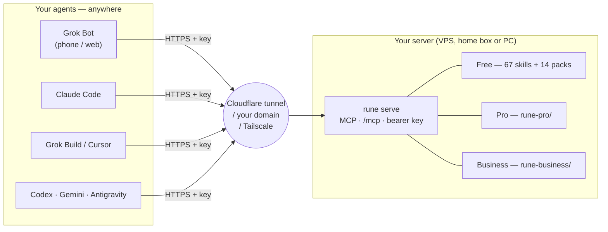
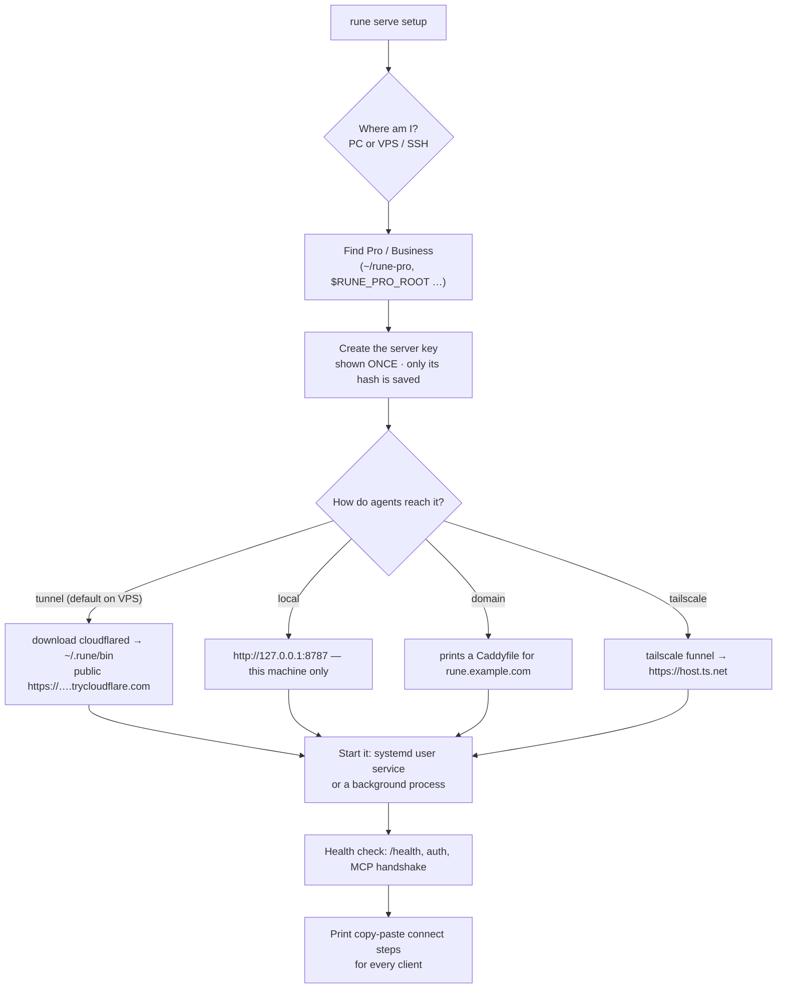

# `rune serve` — one Rune for every agent and every machine

Install Rune **once** on a server (a VPS, a home box, your desktop). Every agent you use — Grok Bot, Claude Code, Grok Build, Cursor, Codex, Gemini / Antigravity, a Telegram bot — connects to it over [MCP](https://modelcontextprotocol.io) and gets your Free + Pro + Business skills **without installing Rune locally**. Update Rune on the server and every agent sees the new skills on its next call.



> **Status:** new in 2.34.0. Until that is on npm, run it from a git checkout: `node compiler/bin/rune.js serve setup`.

## Quick start — 3 steps

**1. Install Rune on the server**

```bash
npm i -g @rune-kit/rune                                              # Node 18+
git clone https://github.com/rune-kit/rune-pro ~/rune-pro            # optional — if you bought Pro
git clone https://github.com/rune-kit/rune-business ~/rune-business  # optional — Business
```

**2. Run the setup wizard**

```bash
rune serve setup
```

It asks three questions (Pro/Business folders, how agents reach it, run as a service?) and then does everything else:



The output ends like this:

```text
  ✓ Rune serve is running (systemd-user, pid 41872)
    local   http://127.0.0.1:8787/mcp
    public  https://quiet-river-1234.trycloudflare.com/mcp
    ✓ MCP handshake OK — 4 tools · Free + Pro + Business

  ┌─ Your server key — shown ONCE. Save it in your password manager now. ─┐
    rune_sk_…
  └────────────────────────────────────────────────────────────────────────┘

  Connect your agents:
  ── Grok Bot ──────────────────────────────────
    Say this to Grok Bot: "Add an MCP connector named rune: URL https://…/mcp, …"
  ── Claude Code ───────────────────────────────
    claude mcp add --transport http --scope user rune https://…/mcp --header "Authorization: Bearer $RUNE_KEY"
  …
```

**3. Connect your agents** — copy the line for each client (`rune serve connect <client>` prints it again at any time):

| Client | What to do |
|---|---|
| **Grok Bot** | Say: *"Add an MCP connector named rune: URL `https://…/mcp`, header `Authorization: Bearer <my rune key>`. Ask me for the key with a secure form."* Paste the key **only** into the secure form. Needs the public https URL. |
| **Claude Code** | `claude mcp add --transport http --scope user rune https://…/mcp --header "Authorization: Bearer $RUNE_KEY"` |
| **Grok Build** | `grok mcp add rune https://…/mcp -H "Authorization: Bearer $RUNE_KEY"` then `grok mcp doctor rune` |
| **Codex** | `codex mcp add rune --url https://…/mcp --bearer-token-env-var RUNE_KEY` |
| **Cursor** | `~/.cursor/mcp.json`: `{"mcpServers":{"rune":{"url":"https://…/mcp","headers":{"Authorization":"Bearer ${env:RUNE_KEY}"}}}}` |
| **Gemini CLI** | `gemini mcp add --transport http --scope user rune https://…/mcp -H "Authorization: Bearer $RUNE_KEY"` |
| **Antigravity** | Settings → MCP servers → remote server, same URL and `Authorization` header |

(`export RUNE_KEY=rune_sk_…` first, in the shell you run those commands from.)

Then just ask: *"use the Rune video skill to plan a 30-second teaser"*, `/rune cook add rate limiting`, *"which Rune skills help with GDPR?"*.

## Let your agent do it (no wizard)

Every step has a flag, so an agent can set up your VPS over SSH end to end. `--yes` skips the questions, `--json` prints a machine-readable report, `--key-out` keeps the key out of the agent's transcript:

```bash
ssh me@my-vps 'npm i -g @rune-kit/rune'
ssh me@my-vps 'rune serve setup --yes --json --expose tunnel --key-out ~/.rune/serve.key'
ssh me@my-vps 'rune serve connect all'
ssh me@my-vps 'RUNE_KEY=$(cat ~/.rune/serve.key) rune serve doctor'   # exit 0 = healthy end to end
```

Then you copy `~/.rune/serve.key` into your password manager and delete the file. Tell your agent *"set up rune serve on my VPS `me@my-vps` and connect Grok Bot"* — Rune's `deploy` skill carries the exact runbook (`skills/deploy/references/rune-serve.md`).

The JSON report has `ok`, `exposure.publicUrl`, `health.local` / `health.public` (reachable, auth enforced, handshake + tool list), `service`, `connect.<client>.text`, `warnings[]` and `next[]`. `key.value` appears only when a key was just created and no `--key-out` was given.

## Day-to-day commands

```bash
rune serve status            # running? pid, version, skills, local + public URL
rune serve doctor            # status + probes local and public endpoints (set RUNE_KEY for a full MCP handshake); exit 1 on problems
rune serve connect grok-bot  # reprint connect steps: grok-bot claude grok codex cursor gemini antigravity | all
rune serve start             # start again with the saved setup (after a reboot without a service)
rune serve stop
rune serve key rotate        # lost the key? mint a new one (old one stops working) — then update each client
```

The key is **never** printed again after setup — not by `status`, `connect` or `doctor`. Lost it? `rune serve key rotate`.

## Setup options

```text
rune serve setup [--yes] [--json]
                 [--expose local|tunnel|domain|tailscale] [--domain rune.example.com]
                 [--port 8787] [--pro-root <dir>] [--business-root <dir>] [--no-tiers] [--skills-dir a,b]
                 [--service | --no-service] [--no-start]
                 [--rotate-key] [--key-out <file>] [--no-download] [--config <file>]
```

| Exposure | Good for | Notes |
|---|---|---|
| `tunnel` (default on a VPS / over SSH) | Grok Bot and any remote agent, no domain | Cloudflare quick tunnel. `cloudflared` is downloaded from Cloudflare's GitHub releases into `~/.rune/bin` if missing (no root). Tries QUIC, falls back to HTTP/2 on TCP 443. **The URL changes when the server restarts** — run `rune serve connect grok-bot` and update the connector, or use `domain`. |
| `local` (default on a desktop) | agents on the same machine | `http://127.0.0.1:8787/mcp`. Grok Bot cannot reach it. |
| `domain` | a fixed URL | Needs DNS → this server and a reverse proxy. Setup prints the Caddyfile block: `rune.example.com { reverse_proxy 127.0.0.1:8787 }` (Caddy gets the certificate). |
| `tailscale` | your tailnet / Funnel | Runs `tailscale funnel --bg 8787` and uses `https://<machine>.<tailnet>.ts.net/mcp`. Funnel must be enabled for the node. |

Keeping it running: on Linux with a systemd user session (most VPSes) setup writes `~/.config/systemd/user/rune-serve.service`, enables and starts it, and tries `loginctl enable-linger` so it survives logout and reboots (`--no-service` to skip). Elsewhere it starts a background process (log: `~/.rune/serve.log`) and tells you how to start it at login. Install Rune globally first (`npm i -g`), not through `npx`, so the service points at a path that stays.

## How it works

`rune serve` exposes the skills installed on that machine as an MCP server:

| Tool | What it does |
|---|---|
| `list_skills(filter?, tier?, kind?)` | Discover skills — keyword search over names and descriptions |
| `get_skill(name)` | The skill's `SKILL.md` (or a pack's `PACK.md`) plus its list of reference files |
| `get_reference(skill, path)` | One file from the skill's folder, e.g. `references/phase-3.md` |
| `run_skill(name, input?)` | The skill's instructions with your request framed for the calling agent to execute now |

It also publishes **MCP prompts**, which most clients show as slash commands: a generic `rune` (`skill` + `task`) and one `rune-<skill>` per user-invocable skill and pack (`rune-cook`, `rune-video-creator`, `rune-pro-media`, …).

The server's MCP *instructions* tell the agent that Rune skills live on this server, so "use the video skill", `/rune video …` or `rune:cook` makes the agent call `run_skill` instead of looking on disk. Names are forgiving: `cook`, `rune:cook`, `/rune cook`, `@rune-pro/media`, a pack's sub-skill (`image-generator`) and an unambiguous prefix (`video` → `video-creator`) all resolve.

What gets served:

- **Free** — the 67 core skills and 14 extension packs from the installed `@rune-kit/rune` package.
- **Pro / Business** — detected exactly like `rune setup` does: `$RUNE_PRO_ROOT` / `$RUNE_BUSINESS_ROOT`, a `../Pro` / `../Business` sibling, or `~/rune-pro` / `~/rune-business`. Override with `--pro-root` / `--business-root`, or skip with `--no-tiers`.
- **Your own** — `--skills-dir a,b` adds folders of `<name>/SKILL.md` skills (tier `custom`).

The catalog is re-scanned every 30 s, so a `git pull` in a tier repo shows up without a restart.

## Advanced: manual setup

Everything `setup` does can be done by hand.

```bash
rune serve                       # http://127.0.0.1:8787/mcp — first run prints the key once
rune serve --tunnel              # + Cloudflare quick tunnel (needs cloudflared)
caddy reverse-proxy --from rune.example.com --to 127.0.0.1:8787     # or Caddy in front
rune serve install [serve flags] # write a systemd user unit (prints the systemctl commands; --print for /etc/systemd/system)
```

Behind a proxy add `--trust-proxy` so the rate limit counts real client IPs (`X-Forwarded-For` / `CF-Connecting-IP`). For containers, set `RUNE_SERVE_KEY` and nothing is written to disk. For a stable Cloudflare hostname, create a named tunnel and point it at `http://127.0.0.1:8787`.

A system-wide unit by hand:

```ini
# /etc/systemd/system/rune-serve.service
[Unit]
Description=Rune skill server (MCP)
After=network-online.target

[Service]
User=rune
ExecStart=/usr/bin/env rune serve --port 8787 --trust-proxy
Restart=on-failure

[Install]
WantedBy=multi-user.target
```

**Other clients**

- **Telegram / custom bots** — any MCP client SDK (TypeScript, Python, Go) with the Streamable HTTP transport and the `Authorization` header; call `run_skill` with the user's message.
- **Clients without custom headers** — start the server with `--allow-query-key` and use `https://…/mcp?key=…`. URLs end up in proxy and client logs, so prefer the header whenever the client supports one.
- **No HTTP at all (stdio over SSH)** — `rune serve --stdio` speaks MCP on stdin/stdout with no key (SSH is the auth): `claude mcp add rune -- ssh my-vps rune serve --stdio`.

## What runs where

`run_skill` returns instructions; **the calling agent does the work with its own tools**. That is the point: a skill that edits your repo (cook, fix, test, rescue …) still edits the repo on your machine — the server only supplies the playbook. Skills that produce a self-contained deliverable (a video plan, copy, a report) need nothing local at all.

Limits to know:

- **Hooks don't run remotely.** preflight / sentinel / completion-gate gating needs `rune hooks install` on the machine where the agent runs. Over MCP, skills are guidance only.
- **`scripts/` don't run remotely.** Skills that call a bundled script describe what it does; the agent emulates it or skips it.
- **User-invoked-only skills** (`launch`, `deploy`, `incident`) are served with a warning that the agent must have an explicit request from you.
- **No server, no skills.** If the VPS is down, agents lose Rune until it is back. Keep a local install where that matters.
- **Your license still applies.** Pro and Business are licensed to you (or your team). Serve them to your own agents, not to the public.

## Experimental: run skills on the server (`--runner`)

```bash
rune serve --runner claude      # or codex | grok — the CLI must be installed and signed in on the server
           [--runner-timeout 600] [--runner-concurrency 2]
```

`run_skill` gains `mode: "execute"`: the server pipes the framed skill to the CLI (`claude -p`, `codex exec -`, `grok --prompt-file`), waits up to the timeout, and returns the output plus a list of files it wrote. Each run gets its own folder under `~/.rune/serve-runs/`. The default stays `mode: "instructions"`, and the agent picks `execute` only for self-contained deliverables — this is the "send `/rune video abc` from a chat bot, get the result back" setup.

- No shell: the CLI is spawned with a fixed argv; the prompt goes over stdin or a file.
- The CLI runs with `acceptEdits` (Claude, Grok) or `--sandbox workspace-write` (Codex) inside the run folder. Anyone with the key can make it work there — treat the key like an SSH key.
- `RUNE_SERVE_KEY` is removed from the CLI's environment.
- User-invoked-only skills (`launch`, `deploy`, `incident`) are never executed server-side.
- Output is capped at 1 MB; at most `--runner-concurrency` runs at once (others get a "busy" answer).

## Security

- Bearer key on every `/mcp` request (constant-time compare against the stored hash); `X-Rune-Key` is accepted too.
- `/health` is public and returns only name, version and skill count.
- Rate limit: 120 requests / minute / IP (`--rate-limit`), plus 10 failed-auth attempts / minute / IP.
- Request bodies over 1 MB are refused; file reads are capped at 256 KB (`--max-bytes`).
- Reads are confined to the skill's own folder: absolute paths, `..` and symlinks that leave the folder are rejected, and only text files are served.
- The MCP server never runs shell commands. (The experimental `--runner` below is the one opt-in exception.)

## Reference

```text
rune serve setup [--yes] [--json] [--expose local|tunnel|domain|tailscale] [--domain <host>]
                 [--service|--no-service] [--no-start] [--rotate-key] [--key-out <file>] [--no-download]
rune serve start | stop                         start with the saved setup / stop it
rune serve status | doctor [--json]             state; doctor also probes local + public (RUNE_KEY → full handshake)
rune serve connect [client|all] [--url <url>]   connect steps, never the key
rune serve [--port 8787] [--host 127.0.0.1]     run in the foreground: Streamable HTTP at /mcp (bearer key)
           [--skills-dir <dir>[,<dir>]]         extra skill folders (tier "custom")
           [--pro-root <dir>] [--business-root <dir>] [--no-tiers]
           [--rate-limit 120] [--max-bytes 262144] [--trust-proxy]
           [--allow-query-key] [--config <file>] [--name rune]
           [--runner claude|codex|grok] [--runner-timeout 600] [--runner-concurrency 2]   (experimental)
           [--tunnel]                                                                    (cloudflared quick tunnel)
rune serve install [--print] [serve flags]      systemd unit (experimental)
rune serve --stdio                              MCP over stdio (local or via ssh)
rune serve key rotate                           mint a new key, print it once
rune serve key path                             where the key hash lives
```

Files: `~/.rune/serve.json` (key hash + saved setup, 0600), `~/.rune/serve-state.json` (running pid, URLs), `~/.rune/serve.log` (background process log), `~/.rune/bin/cloudflared` (if setup downloaded it).

Environment: `RUNE_SERVE_KEY` (fixed key, nothing stored), `RUNE_SERVE_CONFIG` (key file path), `RUNE_KEY` (used by `doctor` for the handshake), `RUNE_PRO_ROOT`, `RUNE_BUSINESS_ROOT`.

The server is stateless Streamable HTTP (JSON responses, no sessions), so it works behind any reverse proxy or load balancer.
