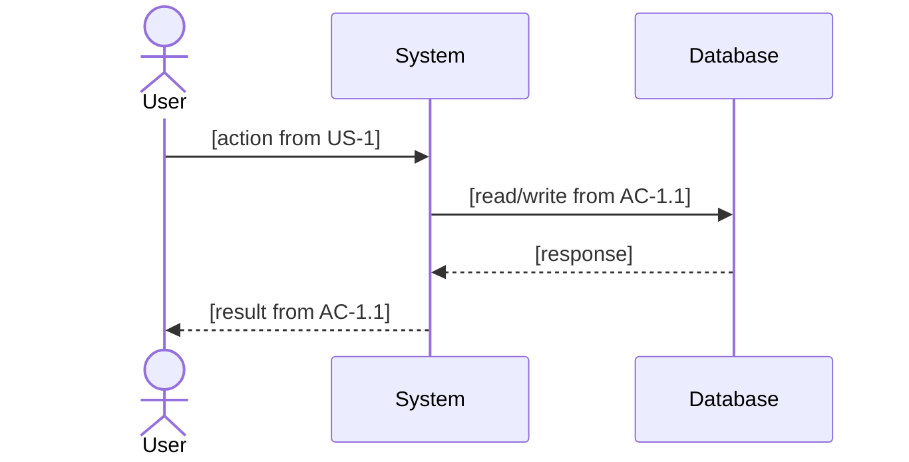
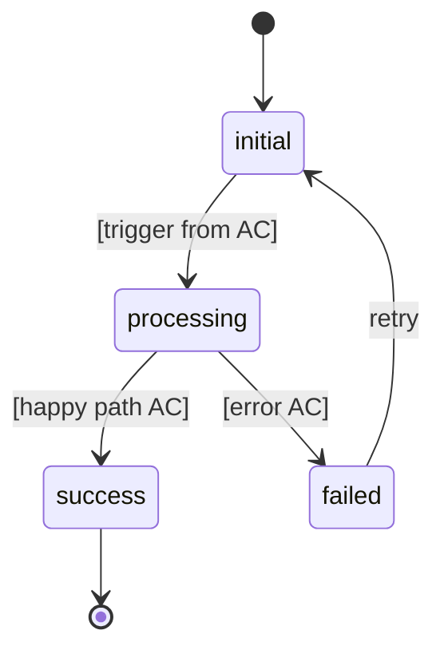

# ba — Artifact triad templates

> Reference for `skills/ba/SKILL.md`. Moved verbatim from SKILL.md in v2.33.0 (progressive disclosure); the SKILL.md section of the same name points here.

#### Artifact 1: requirements.md

Structured document combining Steps 1-6.5. Save to `.rune/features/<feature-name>/requirements.md`:

```markdown
# Requirements Document: [Feature Name]
Created: [date] | BA Session: [summary]

## Context
[Problem statement — 2-3 sentences]

## Stakeholders
- Primary user: [who]
- Affected systems: [what]

## User Stories
[from Step 5 — each with [P1|P2|P3] priority and Independent Test]

## Functional Requirements
[from Step 4.5 — EARS-format FR-n list; skip for Bug Fix/Refactor]

## Key Entities
[from Step 5.5 — mandatory if feature involves data; omit section for stateless features]

## Scope
### In Scope
### Out of Scope
### Assumptions

## Non-Functional Requirements
[from Step 6]

## Dependencies
[from Step 4]

## Risks
- [risk]: [mitigation]

## Strategic Recommendations
[from Step 6.5 — skip for Bug Fix/Refactor]

## Logic Consistency Report
[from Step 3.6 — verbatim, for audit trail]

## Next Step
→ Hand off to rune:plan (consumes all 3 artifacts)
```

#### Artifact 2: requirements.mermaid

Auto-generate from User Stories. Save to `.rune/features/<feature-name>/requirements.mermaid`.

**Sequence diagram** (primary happy path from US-1):



**State machine** (only if any User Story implies state):



Skip state machine if feature is stateless (simple CRUD with no lifecycle). Sequence is always produced.

> For a polished editorial visual, `diagram` can redraw `requirements.mermaid` (sequence → type `sequence`; state machine → type `state`) as self-contained HTML. Offer it when the reader would learn more from a designed figure than from raw Mermaid — `suggested_next: diagram`.

#### Artifact 3: tasks.md

Pre-broken implementation tasks **grouped by user story** (vertical slices), NOT by layer. Plan refines this backbone, does not create from scratch. Save to `.rune/features/<feature-name>/tasks.md`:

```markdown
# Implementation Tasks: [Feature Name]

## Foundational (blocking prerequisites)
> Shared infrastructure NO story can start without. Keep minimal.
- [ ] Schema/migrations for Key Entities shared by 2+ stories
- [ ] Auth/routing/middleware skeleton (only if 2+ stories need it)

## US-1 [P1]: [story title]
> Layer order WITHIN the story: Data → Logic → Endpoint → UI → Test. UI never first.
- [ ] Data: [entity/migration this story owns, if not Foundational]
- [ ] Logic: [each Business Rule this story enforces → one task]
- [ ] Endpoint: [handler/service/API this story calls — skip only if story is pure-UI]
- [ ] UI: [component/surface — calls the Endpoint task above; a UI element and the
      endpoint it calls are ONE story's tasks, never split across stories]
- [ ] Test: [each AC of this story → one test; happy path + error]
- **Checkpoint**: US-1 independently functional — run its Independent Test

## US-2 [P2]: [story title]
- [ ] ... (same internal structure)

## NFR Verification
- [ ] [each NFR from Step 6 → one measurement task]
```

Derivation rules:
- 1 User Story → 1 `## US-n` section containing ALL its layers (data through test) — a story section with only UI/Endpoint tasks and no Logic/Data/Test is a broken slice; a UI task with no Endpoint task above it (and no pure-UI justification) is a dead button in waiting
- 1 Business Rule → 1 Logic task + 1 test task, inside the story that enforces it
- 1 AC → ≥1 Test task inside its story (happy path + error)
- 1 NFR → 1 NFR Verification task
- Foundational holds ONLY what 2+ stories share — story-specific work stays in the story
- P1 sections first; completing all P1 sections + Foundational = viable MVP

**Why story-grouped**: layer-grouped backbones ("all Data → all Logic → all Interface") invite the executor to finish the Interface layer and stop — shipping UI with no wiring. Story-grouped means every completed section is a demoable end-to-end slice.
